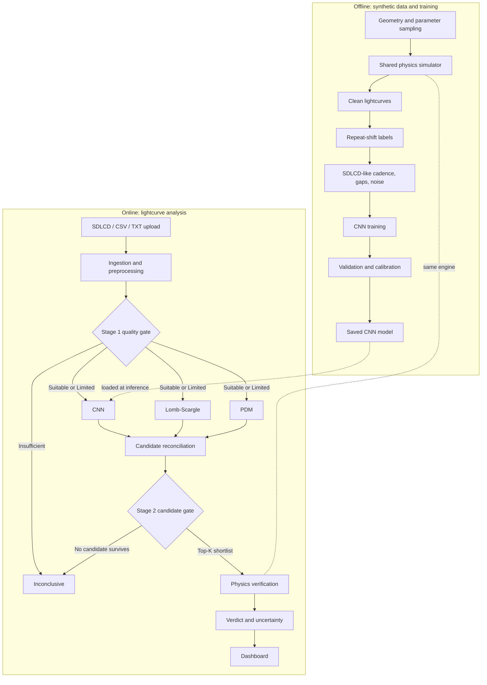

# TumbleScope

**ML-led, physics-checked analysis of space-debris rotation from reflected sunlight.**

[Status](https://img.shields.io/badge/status-design%20proposal-orange) [Track](https://img.shields.io/badge/track-AI%20%26%20ML-blue) [Python](https://img.shields.io/badge/python-3.10%2B-informational)

> **Project status: design proposal.** This repository describes a _proposed_ system, built for Prasunex Innovathon 2026 (Round 2, AI & ML track). The architecture, specifications and numbers below are design targets, not measured results. The [status table](https://claude.ai/chat/d59ce6c1-fdb8-4090-a0be-8cecb1baec25#components-and-status) shows what exists. Nothing here claims real-world accuracy until it has been measured and reported in [`docs/results`](https://claude.ai/chat/d59ce6c1-fdb8-4090-a0be-8cecb1baec25#planned-repository-layout).

---

## Table of contents

1. [Overview](https://claude.ai/chat/d59ce6c1-fdb8-4090-a0be-8cecb1baec25#overview)
2. [Why period estimation is hard](https://claude.ai/chat/d59ce6c1-fdb8-4090-a0be-8cecb1baec25#why-period-estimation-is-hard)
3. [Approach](https://claude.ai/chat/d59ce6c1-fdb8-4090-a0be-8cecb1baec25#approach)
4. [Architecture](https://claude.ai/chat/d59ce6c1-fdb8-4090-a0be-8cecb1baec25#architecture)
5. [Components and status](https://claude.ai/chat/d59ce6c1-fdb8-4090-a0be-8cecb1baec25#components-and-status)
6. [Design details](https://claude.ai/chat/d59ce6c1-fdb8-4090-a0be-8cecb1baec25#design-details)
7. [Scope and limitations](https://claude.ai/chat/d59ce6c1-fdb8-4090-a0be-8cecb1baec25#scope-and-limitations)
8. [Data](https://claude.ai/chat/d59ce6c1-fdb8-4090-a0be-8cecb1baec25#data)
9. [Evaluation plan](https://claude.ai/chat/d59ce6c1-fdb8-4090-a0be-8cecb1baec25#evaluation-plan)
10. [Tech stack](https://claude.ai/chat/d59ce6c1-fdb8-4090-a0be-8cecb1baec25#tech-stack)
11. [Planned repository layout](https://claude.ai/chat/d59ce6c1-fdb8-4090-a0be-8cecb1baec25#planned-repository-layout)
12. [Getting started (planned)](https://claude.ai/chat/d59ce6c1-fdb8-4090-a0be-8cecb1baec25#getting-started-planned)
13. [Roadmap](https://claude.ai/chat/d59ce6c1-fdb8-4090-a0be-8cecb1baec25#roadmap)
14. [Team](https://claude.ai/chat/d59ce6c1-fdb8-4090-a0be-8cecb1baec25#team)
15. [References](https://claude.ai/chat/d59ce6c1-fdb8-4090-a0be-8cecb1baec25#references)
16. [License and data terms](https://claude.ai/chat/d59ce6c1-fdb8-4090-a0be-8cecb1baec25#license-and-data-terms)

---

## Overview

Defunct satellites and rocket bodies keep orbiting Earth, often spinning or tumbling without control. From the ground they are only points of light. As an object rotates, the sunlight it reflects toward a telescope changes, and the resulting brightness-versus-time record, a **lightcurve**, carries a signature of its rotation.

TumbleScope takes a lightcurve and estimates its **apparent (synodic) rotational period**. It does not stop at a single number. It:

1. **Proposes** candidate periods with a 1D CNN.
2. **Cross-checks** them with two independent classical methods, Lomb–Scargle and Phase Dispersion Minimisation (PDM).
3. **Tests plausibility** by fitting a simplified forward physics model to the observation and comparing each candidate against decoy periods.
4. **Assesses** the evidence and returns an honest verdict: **Supported**, **Ambiguous** or **Inconclusive**, with reason codes and alternatives.

> **Estimate. Cross-check. Test plausibility. Assess.**

TumbleScope is a research and educational prototype. It is not an operational space-surveillance system.

## Why period estimation is hard

- **Irregular sampling and gaps.** Telescope passes are short and uneven.
- **Noise.** Instrument and observing conditions can hide the repeating pattern.
- **Harmonic ambiguity.** A symmetric object can repeat its brightness pattern twice per rotation, so P and 2P can both look right.
- **Sampling aliases.** Observation cadence creates misleading periodic peaks.
- **Unknown physics.** Shape, reflectivity and viewing geometry are rarely known.

**Apparent vs physical period.** The _physical (sidereal)_ period is the true rotation relative to an inertial frame. The _apparent (synodic)_ period is the brightness-repeat period shaped by viewing geometry. TumbleScope predicts the apparent period, which is the quantity the Space Debris Light Curve Database (SDLCD) reports.

## Approach

|Stage|What it does|
|---|---|
|**Signal analysis**|A CNN, Lomb–Scargle and PDM independently propose candidate periods.|
|**Candidate verification**|Candidates are clustered and checked for harmonic and alias relationships. The top-K are tested against the observation with a shared physics simulator, including held-out time blocks and decoy periods.|
|**Evidence-based assessment**|Observation quality, method agreement and verification results are combined into a verdict with uncertainty and reason codes.|

**Central hypothesis.** (1) Reconciling CNN, Lomb–Scargle and PDM retains the true candidate more often than any single method. (2) Physics verification plus calibrated abstention reduces false-_Supported_ verdicts, especially on noisy, short or gapped observations. Both are tested, not assumed. See [Evaluation plan](https://claude.ai/chat/d59ce6c1-fdb8-4090-a0be-8cecb1baec25#evaluation-plan).

## Architecture



An **evaluation and calibration** layer sits beside both workflows: synthetic ground truth, held-out simulator variants and real SDLCD reference labels feed baselines, ablations and stress tests, and then calibration and threshold selection. The final model and configuration are frozen before the test run.

### Key design decisions

- **One simulator, two uses.** The same forward-simulation engine generates labelled training data offline and tests candidate periods online. This keeps the two consistent. It does **not** remove the synthetic-to-real gap.
- **Two quality gates.** Stage 1 judges the _observation_ before estimation. Stage 2 judges each _candidate_ after reconciliation and before the expensive physics step. If every candidate fails Stage 2, the verdict is _Inconclusive_.
- **Reference labels never reach inference.** SDLCD reference periods are used only in the evaluation workflow.
- **Labels do not come from the classical methods.** Training labels are derived from the clean simulated curve, so the CNN does not just learn to copy Lomb–Scargle or PDM.
- **Harmonics are hypotheses, decoys are not.** P and 2P are competing physical interpretations. Decoys are deliberately non-harmonic, non-alias periods.
- **Fast mode never lowers the bar.** Fast mode reduces search effort, not the acceptance standard for _Supported_.

## Components and status

|#|Component|Purpose|Main tools|Status|
|---|---|---|---|---|
|1|Data ingestion|Parse SDLCD / CSV / TXT into a standard `Observation`|Python, Pandas, NumPy|Planned|
|2|Preprocessing and quality gates|Sort, validate, normalise, flag gaps and suspicious points, assess quality|NumPy, SciPy, Astropy|Planned|
|3|CNN period estimator|Probability distribution over apparent-period bins|PyTorch|Planned|
|4|Classical analysis|Multi-term Lomb–Scargle and PDM candidate periods|Astropy, NumPy|Planned|
|5|Candidate reconciliation|Cluster, harmonic/alias analysis, rank, top-K|NumPy, SciPy|Planned|
|6|Physics verification|Forward simulation, fitting, held-out blocks, decoys|NumPy, SciPy|Planned|
|7|Verdict and uncertainty|Supported / Ambiguous / Inconclusive with reason codes|Python, scikit-learn|Planned|
|8|Dashboard|Interactive analysis, plots and 3D viewer|Streamlit, Plotly|Planned|
|—|Evaluation harness|Baselines, ablations, stress tests, calibration|Python, scikit-learn|Planned|

> Update the **Status** column as components are built (for example `Prototype`, `Working`, `Evaluated`).

## Design details

### Preprocessing

- Sort timestamps and brightness **together** and detect duplicates, gaps and missing values. Missing data is never treated as a brightness of zero.
- Robust normalisation. Bright outliers are **flagged, not deleted**, because they may be genuine glints.
- Originals are preserved. No automatic detrending by default.
- **Stage 1 (observation level):** valid measurement count, duration, gaps, noise, sampling and exposure. Suitable → proceed; Limited → proceed with warnings; Insufficient → _Inconclusive_.
- **Stage 2 (candidate level):** cycles observed, frequency resolution, candidate separation, aliases.

### CNN period estimator (proposed design)

|Element|Initial design|
|---|---|
|Model|Dilated residual 1D CNN (PyTorch)|
|Input|3 channels × 1,024 positions: normalised brightness, validity mask, time difference Δt|
|Residual blocks|6, one dilated convolution each|
|Channels|32 → 32 → 64 → 64 → 128 → 128|
|Kernel / dilations|7 / 1, 2, 4, 8, 16, 32|
|Aggregation|Global average pooling|
|Output|128 logarithmically spaced apparent-period bins + a _No Reliable Period_ class|
|Targets|Soft labels in log-period space|
|Size (design estimate)|≈ 0.25 M parameters, ≈ 379-position receptive field|

_The parameter count and receptive field are design estimates to be checked against the implemented network._

- Short observations are right-padded and masked. Long ones are split into overlapping windows, and window predictions are combined by a **weighted average** (not a product, since overlapping windows are not independent). Strong disagreement between windows is kept as ambiguity.
- The time axis is not resized, so absolute time scale is preserved.
- Confidence is calibrated on held-out data before being used as evidence.

### Synthetic training data

1. Sample geometry, reflectivity, rotation and observing parameters.
2. Run the simulator to get a clean, densely sampled curve.
3. Label it with the smallest repeat shift that matches the pattern within a similarity tolerance.
4. Degrade it with SDLCD-like cadence, gaps, noise and missing data.
5. Train the CNN on the degraded curve with the clean-curve label.

**No Reliable Period** examples come from three sources: non-periodic signals (pure noise), complex or multi-frequency signals, and under-covered observations (too few cycles or too little resolution). Cut-offs are set by injection-and-recovery experiments, not arbitrarily.

Development targets: 1,000 curves (generator and label pilot) → 20,000 (MVP corpus) → 50,000 (stretch). These are targets, not completed counts.

### Candidate reconciliation

Candidates from the three estimators are clustered with tolerances tied to frequency resolution, then checked for harmonic (P vs 2P) and sampling-alias relationships. Each candidate is scored on normalised evidence:

$$S(P) = w_C,R_C(P) + w_L,R_{LS}(P) + w_D,R_{PDM}(P) - \lambda_A,A(P)$$

where $R_C$ is calibrated CNN support, $R_{LS}$ and $R_{PDM}$ are normalised Lomb–Scargle and PDM support, $A(P)$ is the sampling-window alias likelihood, $w_C, w_L, w_D$ are estimator weights and $\lambda_A$ is the alias-risk penalty. Raw LS power, PDM dispersion and CNN probability are **not** added directly. Weights are tuned on validation data and frozen before final testing. The initial shortlist is the **top 5** candidate clusters, subject to profiling.

### Physics simulator

- Objects: box, cylinder (rocket body), and box with solar panels (panels are a stretch item).
- Surfaces are facets with area, normal and reflectivity; single-axis rotation; fixed or simplified Sun and observer directions.
- Reflection: Lambertian diffuse, with an optional Phong-style specular term.

$$B \propto A,\rho,\max(0,\mathbf{n}\cdot\mathbf{s}),\max(0,\mathbf{n}\cdot\mathbf{o})$$

- Brightness convention is preserved: linear flux/ADU is fitted with a scale and offset; magnitudes use $m_{sim} = -2.5\log_{10}(F_{sim}) + C$ with a fitted zero point $C$; unknown conventions fall back to a labelled normalised-shape comparison.
- **Not modelled:** full tumbling dynamics, detailed self-shadowing, exact 3D reconstruction.

### Physics verification protocol

1. **Fit** supported geometries, orientations and surface properties for each shortlisted candidate.
2. **Solve scale and offset analytically** by least squares: $y_{obs}(t) \approx a,F_{sim}(t) + b$.
3. **Optimise** the remaining parameters with a coarse search, then SciPy differential evolution, with fixed seeds and restarts.
4. **Hold out time blocks:** fit on selected contiguous blocks and score on separate contiguous blocks.
5. **Compare harmonic hypotheses** (P vs 2P) as competing interpretations, using an odd/even-cycle check and AIC/BIC when model complexity differs.
6. **Compare against non-harmonic decoys** (for example 1.37P and 0.61P), excluding known aliases and separating them from the candidate by more than the effective resolution, with equal optimisation budgets.
7. **Evaluate on held-out simulator variants** and report ROC-AUC for true-candidate vs decoy separation, using $\Delta E = E_{decoy} - E_{candidate}$.

A good fit shows compatibility with a _model_. It is not proof of the object's true shape or rotation state, and synthetic AUC is not evidence of real-world accuracy.

### Verdicts

|Verdict|Meaning|
|---|---|
|**Supported**|At least one candidate meets the calibrated adequacy, estimation and verification requirements.|
|**Ambiguous**|Multiple plausible candidates or explanations remain, or required verification is incomplete.|
|**Inconclusive**|Observation quality or available evidence is insufficient for a reliable estimate.|

Reason codes: `low_quality`, `no_periodic_signal`, `conflicting_methods`, `harmonic_ambiguity`, `alias_ambiguity`, `candidate_inadequate`, `model_mismatch`, `geometry_uncertainty`, `verification_incomplete`.

Thresholds and calibration are set on object-disjoint validation data. The system reports the measured false-_Supported_ rate and risk–coverage behaviour, and does not treat raw CNN probability as confidence. If verification cannot finish, the result is _Ambiguous_ with `verification_incomplete`, never _Supported_.

## Scope and limitations

**In scope:** optical lightcurve analysis, apparent-period estimation, candidate verification, uncertainty assessment.

**Out of scope:** collision prediction, full orbital determination, exact 3D reconstruction, complete recovery of tumbling states, operational surveillance use.

**Known limitations**

- **Synthetic-to-real gap.** Training on simulated curves cannot guarantee performance on real debris. Real glints, complex surfaces and tumbling are not captured by a box/cylinder simulator. Mitigations: real cadence, gaps and noise, waveform diversity, held-out simulator variants, real-data validation, and classical and physics checks that do not depend on the CNN. Synthetic and real results are reported separately.
- **Reference labels are references, not ground truth.** SDLCD reports synodic periods that carry their own uncertainty. Only a subset of objects have them, and some period fields are reserved internal codes that must be excluded.
- **Short passes and ambiguity.** Some observations cannot support a single period. The system is designed to say so.
- **Simplified physics.** The 3D viewer shows a _plausible fitted configuration_, not a reconstruction of the real object.

## Data

**Real data:** the [Space Debris Light Curve Database (SDLCD)](https://www.sdlcd.space-debris.sk/), maintained at Comenius University in Bratislava. Data Release 3 lists 2,224 lightcurves of 791 objects, 419 of which have reported periods (figures as displayed on the site; re-check before relying on them).

Before use, inspect the real files to confirm:

- the per-measurement column layout and time convention,
- the brightness convention (the observations use an arbitrary instrumental magnitude system),
- which period values are genuine and which are reserved codes.

SDLCD supplies sampling and noise patterns for the synthetic data and reference periods for evaluation. Reference periods are never used as training labels. Check SDLCD's terms of use and citation requirements before redistributing any data.

**Synthetic data:** generated by the shared simulator. See [Design details](https://claude.ai/chat/d59ce6c1-fdb8-4090-a0be-8cecb1baec25#synthetic-training-data).

## Evaluation plan

**Compared configurations**

|Configuration|What it tests|
|---|---|
|Lomb–Scargle only|Classical baseline (single-term vs multi-term as an ablation)|
|PDM only|Folding-method baseline|
|CNN only|Direct ML estimation|
|CNN + classical|Benefit of reconciliation|
|Complete system|Added value of physics verification and uncertainty assessment|

A gradient-boosting model on periodogram features is a possible extra baseline, to test whether the CNN is justified over a simpler ML model.

**Metrics**

- _Period estimation:_ median log-period error, tolerance accuracy, harmonic error rate, catastrophic error rate.
- _Candidates and verification:_ Recall@K, candidate retention, decoy rejection, false-acceptance rate, ROC-AUC on held-out simulator variants.
- _Decision reliability:_ false-_Supported_ rate, accuracy among _Supported_ results, coverage, risk–coverage curve, Brier score, Expected Calibration Error.

**Controlled stress tests:** increased noise, shorter baselines, larger gaps, lower brightness modulation, uneven sampling. Results are reported per observation-quality group (Suitable, Limited, Insufficient). Both estimation accuracy and correct abstention are evaluated.

**Ablations:** with/without the timing channel, with/without noise and gap augmentation, single-term vs multi-term Lomb–Scargle, with/without harmonic and alias checks, diffuse-only vs diffuse + specular, full system vs no physics verification.

**Split policy:** real observations are split **by object** so one object never appears in more than one of training, validation and test. Candidate-fitting validation uses contiguous temporal blocks. Numeric targets are set from pilot and baseline runs and frozen before the final holdout evaluation.

## Tech stack

|Area|Tools|
|---|---|
|Core|Python, NumPy, Pandas, SciPy|
|Astronomy|Astropy (Lomb–Scargle, time handling)|
|Machine learning|PyTorch, scikit-learn (calibration, metrics)|
|Physics and optimisation|NumPy, SciPy (differential evolution)|
|Interface|Streamlit, Plotly (interactive plots, 3D viewer), Matplotlib|
|Training environment|Single GPU or Google Colab|
|Future|FastAPI, job queue, Docker, ONNX/CPU inference export|

**MVP architecture:** Streamlit calls modular Python directly through an analysis controller. FastAPI and React are future extensions, not prototype requirements.

## Planned repository layout

```text
TumbleScope/
├── app/                    # Streamlit dashboard and analysis controller
├── ingestion/              # SDLCD / CSV / TXT adapters, validation, Observation
├── preprocessing/          # time handling, masks, normalisation, quality gates
├── classical_analysis/     # Lomb–Scargle, PDM, candidate extraction
├── reconciliation/         # clustering, harmonic/alias analysis, ranking
├── physics/                # geometry, rotation, reflection, simulator, fitting
├── ml/                     # dataset generation, CNN, training, calibration
├── verdict/                # evidence, decision rules, reason codes
├── evaluation/             # baselines, ablations, stress tests, metrics
├── configs/                # versioned simulation, model and decision configs
├── tests/
├── docs/                   # design notes and, later, measured results
└── README.md
```

This is a proposed layout and will change as the code is written.

## Getting started (planned)

No installable package exists yet. The workflow below is the **intended** developer experience. Treat the commands as placeholders until the repository contains the code.

```bash
git clone https://github.com/garvit389/TumbleScope.git
cd TumbleScope
python -m venv .venv && source .venv/bin/activate   # Windows: .venv\Scripts\activate
pip install -r requirements.txt                     # planned

# planned entry points
python -m ml.generate_dataset --config configs/pilot.yaml   # synthetic curves
python -m ml.train --config configs/cnn.yaml                # train the CNN
streamlit run app/main.py                                   # dashboard
```

## Roadmap

The development window is one week, run as two parallel tracks (a scientific track and an ML track). The plan is built so that a delay costs a feature, not the demo.

|Phase|Focus|
|---|---|
|0|Data audit: parse real SDLCD files|
|1|Thin slice: upload → Lomb–Scargle → dashboard|
|2|Preprocessing, PDM, Stage 1 gate|
|3|Simulator and 1,000-curve pilot with labels|
|4|CNN training and synthetic holdout evaluation|
|5|Reconciliation, top-K verification, decoys|
|6|Verdict logic, Stage 2 gate, dashboard integration|
|7|Final validation, cached demo, report|

**In the one-week MVP:** ingestion, preprocessing and both quality gates; Lomb–Scargle, PDM and reconciliation; a compact CNN on a 5–20k synthetic corpus; box and cylinder with diffuse single-axis rotation; top-K verification with decoys and held-out blocks; three-verdict output with reason codes; Streamlit dashboard with a cached demo.

**Stretch (cut first, in this order):** Thorough mode → solar-panel geometry and specular reflection → larger corpus (50k) → full object-disjoint SDLCD evaluation → 3D viewer polish.

**Later extensions:** SGP4/CelesTrak observation geometry, torque-free tumbling, stable-spin vs tumbling classification, calibration study, batch processing, FastAPI backend.

**Fallbacks.** If the CNN underperforms, the pipeline still runs on Lomb–Scargle + PDM + reconciliation and the CNN is reported as experimental. If verification is not ready, the result is _Ambiguous_, never _Supported_.

## Team

**Team Ebarbs**, AI & ML track, Prasunex Innovathon 2026.

- Garvit Sati
- Akshat Garg

## References

1. Space Debris Light Curve Database (SDLCD), Data Release 3. Faculty of Mathematics, Physics and Informatics, Comenius University in Bratislava. [https://www.sdlcd.space-debris.sk/](https://www.sdlcd.space-debris.sk/)
2. Scargle, J. D. (1982). _Studies in Astronomical Time Series Analysis. II. Statistical Aspects of Spectral Analysis of Unevenly Spaced Data._ The Astrophysical Journal, 263, 835–853. DOI: 10.1086/160554
3. Stellingwerf, R. F. (1978). _Period Determination Using Phase Dispersion Minimization._ The Astrophysical Journal, 224, 953–960. DOI: 10.1086/156444
4. Allworth, J., Windrim, L., Bennett, J. & Bryson, M. (2021). _A Transfer Learning Approach to Space Debris Classification Using Observational Light Curve Data._ Acta Astronautica, 181, 301–315. DOI: 10.1016/j.actaastro.2021.01.048
5. Trummer, N. M., Reza, A., Steindorfer, M. A. & Helling, C. (2025). _Machine Learning-Based Classification for Single Photon Space Debris Light Curves._ Acta Astronautica, 226, 542–554. DOI: 10.1016/j.actaastro.2024.10.066
6. Guo, C., Pleiss, G., Sun, Y. & Weinberger, K. Q. (2017). _On Calibration of Modern Neural Networks._ Proceedings of the 34th ICML, 70, 1321–1330.
7. Phong, B. T. (1975). _Illumination for Computer Generated Pictures._ Communications of the ACM, 18(6), 311–317.
8. Astropy Collaboration. _Lomb–Scargle Periodograms._ Astropy Time Series documentation.
9. SciPy Developers. `scipy.optimize.differential_evolution`. SciPy Reference Guide.

## License and data terms

_License: to be added._ Add a `LICENSE` file before publishing (for example MIT or Apache-2.0). Third-party data, including SDLCD observations, remains subject to its own terms and citation requirements and is not covered by this repository's license.